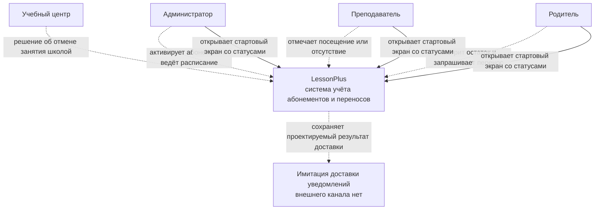
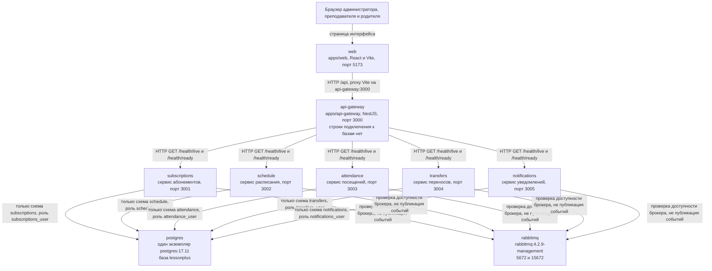
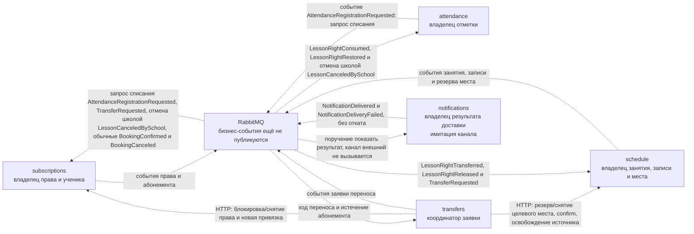

# C4: контекст и контейнеры

Объём C4 на этом этапе — уровни System Context и Container. Последовательности сценариев — в [interactions.md](interactions.md). Схемы записаны в Mermaid. Исходники лежат в [diagrams](diagrams/) и для C4 повторены ниже, чтобы просмотр в Markdown не требовал отдельного рендера.

Код бизнес-сценариев не появился. Сплошная линия на схемах — то, что каркас уже делает. Пунктир — проект из [domain.md](domain.md) и [event-catalog.md](event-catalog.md).

## Легенда

| Знак | Состояние |
| ---- | --------- |
| Сплошная стрелка | Работает в каркасе: интерфейс, proxy `/api`, сбор статусов, своя схема PostgreSQL, проверка RabbitMQ |
| Пунктир | Спроектировано. HTTP-команд между сервисами, публикации 20 бизнес-событий и доставки сообщений в коде нет |
| Имитация доставки | «Уведомления» хранят только проектируемый результат. Почтового, SMS или иного внешнего канала нет |
| Нет на схемах | Реальные платежи и CRM. Их нет ни в Compose, ни в зависимостях приложений |

Платежи и CRM не показаны даже как будущие системы.

## System Context

Уровень C4: System Context. Учебный центр, три роли и система LessonPlus. Действия ролей — проектируемые сценарии. Уже сейчас каждый из них может открыть стартовый экран: он показывает статусы пяти сервисов и заглушки разделов.

Исходник: [diagrams/c4-context.mmd](diagrams/c4-context.mmd).

| Кто | Действие | Куда попадает в системе | Состояние |
| --- | -------- | ----------------------- | --------- |
| Учебный центр | Отмена занятия школой | «Расписание» публикует `LessonCanceledBySchool`. Право сохраняет «Абонементы», лимит переносов не тратится | Проект |
| Администратор | Активация абонемента и ведение расписания | «Абонементы» и «Расписание» | Проект |
| Преподаватель | Отметка посещения или отсутствия | «Посещения» | Проект |
| Родитель | Остаток и заявка на перенос | Остаток у «Абонементов», заявка у «Переносов» | Проект |
| Все трое людей | Стартовый экран | `apps/web` запрашивает `GET /api/system/status` | Работает |
| Имитация доставки | Результат без внешнего канала | «Уведомления», события `NotificationDelivered` и `NotificationDeliveryFailed` | Проект |

## Container: что уже связано

Уровень C4: Container. Процессы совпадают с `compose.yaml`. PostgreSQL один: образ `postgres:17.11`, база `lessonplus`. Пять подписей на стрелках — схемы и роли из `infra/postgres/init/001-roles.sh`, не отдельные серверы. Это логическая изоляция, не пять физических баз — [storage/02-storage-and-isolation.md](storage/02-storage-and-isolation.md). Роль инициализации `POSTGRES_USER` сервисам не выдаётся. Gateway переменной базы не получает: в `loadGatewayConfig` есть только HTTP-адреса сервисов.

Исходник: [diagrams/c4-container.mmd](diagrams/c4-container.mmd).

Чужой схемы на этой схеме нет. `ServiceStatusClient` ходит только в `/health/live` и `/health/ready`. В Docker адреса заданы именами контейнеров: `http://subscriptions:3001` и остальные. Браузер этих имён не использует.

## Container: спроектированные связи

Уровень C4: Container. Пунктир не реализован. Синхронные вызовы делает координатор к владельцу данных. Прямое чтение чужих таблиц запрещено. Межсервисный обмен идёт через API и события.

Исходник: [diagrams/c4-container-designed.mmd](diagrams/c4-container-designed.mmd).

Порядок переноса тот же, что в каталоге: блокировка исходного неиспользованного права, резерв целевого места, commit новой привязки, подтверждение новой записи, освобождение исходного места. До commit допустима компенсация. После commit операцию доводят до конца, компенсация запрещена. Инвариант защиты целевого резерва от истечения обязателен, но доставка `LessonRightTransferred` его не закрывает — см. [interactions.md](interactions.md). Снятие целевого hold при компенсации — только после `LessonRightReleased` (проекция `compensated_right_releases` у schedule). `BookingCanceled` исходной записи в этом потоке получает «Переносы»; обычная отмена записи по-прежнему адресована «Абонементам» и не должна снимать уже новую привязку.

Запрос списания на схеме проведён событием `AttendanceRegistrationRequested`, как в каталоге. Отдельного HTTP-клиента «Посещений» в репозитории нет.

| Связь | Назначение | Состояние |
| ----- | ---------- | --------- |
| `transfers` → HTTP `subscriptions` | Заблокировать исходное неиспользованное право, снять блокировку до commit, зафиксировать новую привязку | Проект |
| `transfers` → HTTP `schedule` | Зарезервировать целевое место, снять его при компенсации (после Released), подтвердить новую запись, освободить исходное место | Проект |
| `AttendanceRegistrationRequested` | «Посещения» просят «Абонементы» списать право | Проект |
| `LessonRightConsumed` | «Абонементы» подтверждают списание, «Посещения» фиксируют результат, «Уведомления» готовят сообщение | Проект |
| `LessonRightRestored` | «Абонементы» возвращают право; «Посещения» и «Уведомления» узнают об этом | Проект |
| `LessonRightReserved` | Блокировка права до новой привязки. Получатель координации — «Переносы» | Проект |
| `LessonRightReleased` | Снятие блокировки права при компенсации. Получатели — «Переносы» и «Расписание» (проекция для безопасного seat release) | Проект |
| `LessonRightTransferred` | Новая привязка уже commit у «Абонементов». Получатели — «Переносы» и «Расписание». Событие само по себе не защищает резерв от TTL | Проект |
| `TransferSeatReserved` | «Расписание» сообщает «Переносам», что целевое место удержано | Проект |
| `BookingConfirmed` | В переносе — шаг после новой привязки для «Переносов». Вне переноса «Абонементы» связывают право с записью | Проект |
| `BookingCanceled` | Обычная отмена снимает привязку у «Абонементов». Освобождение старого места переноса идёт «Переносам» и новую привязку не снимает | Проект |
| `LessonCanceledBySchool` | «Расписание» сообщает отмену школой «Абонементам», «Переносам», «Посещениям» и «Уведомлениям» | Проект |
| `LessonScheduled` | Новое занятие для «Уведомлений» | Проект |
| `SubscriptionActivated`, `SubscriptionExpired` | Состояние абонемента. Истечение также останавливает новые заявки у «Переносов» | Проект |
| `TransferRequested` | «Переносы» начинают координацию «Расписания» и «Абонементов» | Проект |
| `TransferCompleted`, `TransferRejected` | Итог заявки для «Уведомлений». Отказ только до новой привязки | Проект |
| `AttendanceRecorded`, `AbsenceRecorded` | Окончательная отметка для «Уведомлений». Правило списания при отсутствии не задано | Проект |
| `NotificationDelivered`, `NotificationDeliveryFailed` | Результат имитации. Бизнес-получателя нет, операция не отменяется | Проект |

## Границы

Gateway — вход интерфейса. Сейчас он отдаёт собственный health, Swagger `/docs` и `GET /api/system/status`. Бизнес-правил и базы у него нет, поэтому статус сервиса нельзя подделать ответом gateway без опроса самого сервиса.

«Переносы» выделены отдельно, потому что заявка связывает два владельца: право меняют только «Абонементы», место и запись — только «Расписание». Координатор не получает их таблицы. Так перенос и списание одного права можно согласовать, не смешивая остаток и вместимость. Владение сущностями и запрет JOIN через схемы — в [storage-architecture.md](storage-architecture.md) и [storage/01-data-ownership.md](storage/01-data-ownership.md).

«Уведомления» независимо хранят результат доставки. Их отказ не входит в транзакцию абонемента, записи или переноса. Внешний канал не подключён: на контекстной схеме это отдельная имитация, а не интеграция.

Внутренние каталоги бизнес-сервиса уже есть, сценариев в них нет:

| Слой | Каталог | Что в коде |
| ---- | ------- | ---------- |
| Domain | `services/*/src/domain` | Только README. Классов тарифа, права, записи и заявки нет |
| Application | `services/*/src/application` | `check-readiness.ts`, порты outbox и `processed_events` |
| Infrastructure | `services/*/src/infrastructure` | Prisma к своей схеме и проверка RabbitMQ |
| Presentation | `services/*/src/presentation` | `GET /health/live` и `GET /health/ready` |
| Composition root | `app.module.ts`, `bootstrap.ts` | Связывает проверки и порты. Команд абонемента, записи и переноса не вызывает |

У gateway слоёв domain нет. Есть `src/presentation` и `src/infrastructure/service-status.client.ts`. Библиотеки `@lessonplus/contracts` и `@lessonplus/config` процессами Compose не являются: в контрактах конверт и 20 имён событий, в конфигурации проверка переменных окружения.
