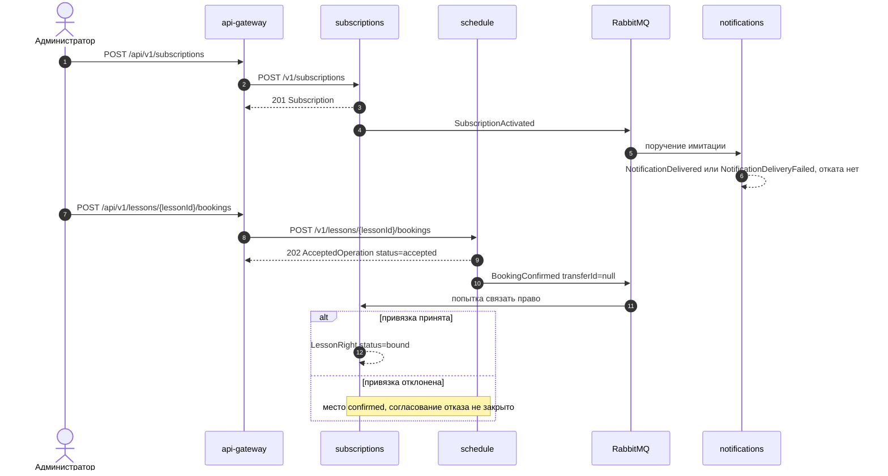
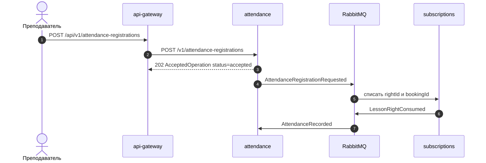
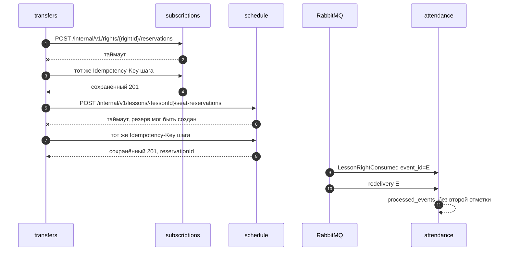
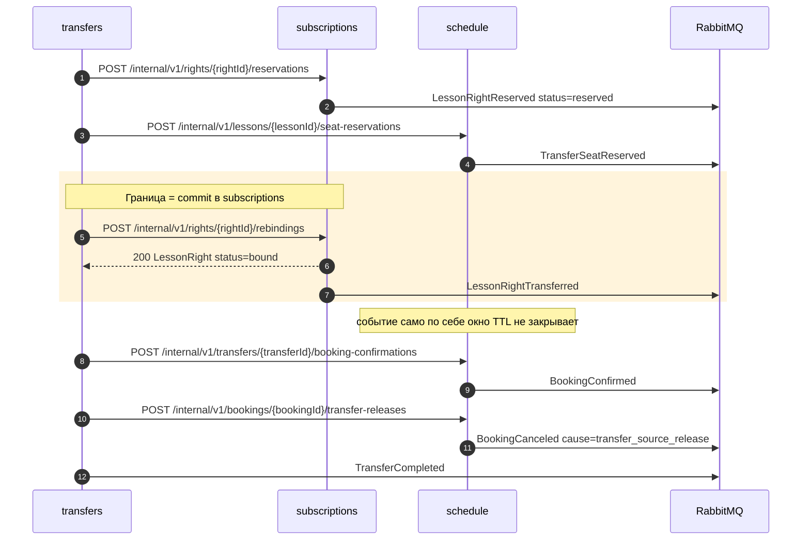
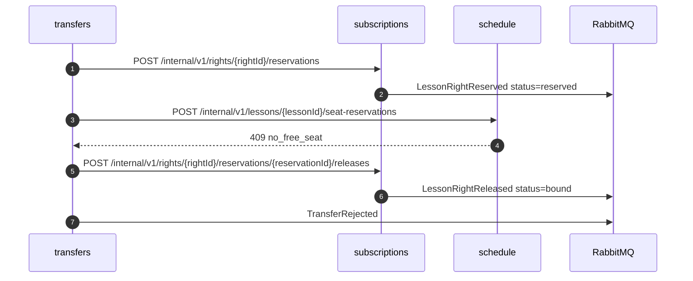
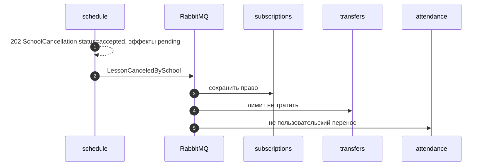
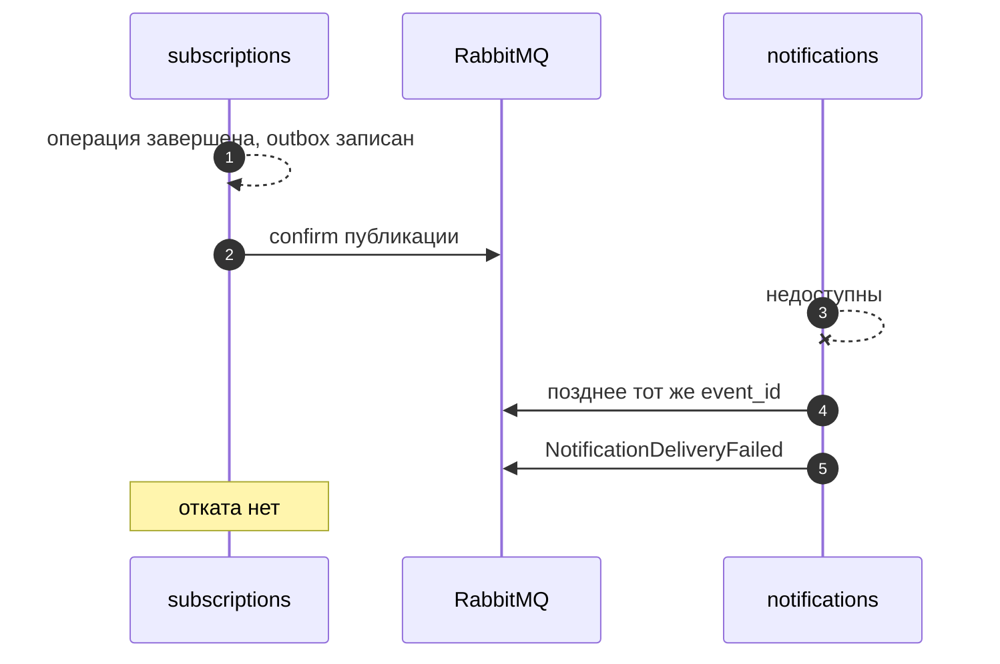

# Взаимодействия сервисов

Карта синхронных запросов и асинхронных команд/событий до этапа хранения. Saga-движок и бизнес-обработчики не запускаются.

Пометки: **существует** — работает в каркасе; **проектируется** — контракт есть, вызова нет. Маршруты сверены с OpenAPI, имена фактов — с каталогом 20 событий, владельцы — с [domain.md](domain.md).

## Что уже связано

Gateway опрашивает health сервисов. Сервисы проверяют PostgreSQL своей схемы и соединение с RabbitMQ. Браузер ходит только на `/api`. Бизнес-HTTP между сервисами, диспетчер outbox и потребители 20 фактов не существуют.

| Источник | Получатель | Назначение | Тип | Контракт | Таймаут | Повторы | Идемпотентность | Отказ |
| -------- | ---------- | ---------- | --- | -------- | ------- | ------- | --------------- | ----- |
| `apps/web` | `api-gateway` | Стартовый экран | синхронный запрос | `GET /api/system/status` → `SystemStatus` | нет отдельного клиентского таймаута в коде UI | нет | GET без ключа | экран показывает недоступность |
| `api-gateway` | каждый бизнес-сервис | Сбор live/ready | синхронный запрос | `GET /health/live`, `GET /health/ready` | **5 с**, `PROBE_TIMEOUT_MS` в `service-status.client.ts` | нет, параллельный опрос | нет | `down`, gateway сам остаётся доступен |
| бизнес-сервис | RabbitMQ | Readiness брокера | синхронная проверка | `RABBITMQ_URL`, не публикация | **3 с**, `CONNECT_TIMEOUT_MS` | нет | нет | `GET /health/ready` → 503 телом readiness, не схемой `Error` |
| бизнес-сервис | PostgreSQL своей схемы | Readiness базы | синхронная проверка | `DATABASE_URL` этой роли | соединение **3 с**, `connectionTimeoutMillis: 3000` в `PrismaPg` каждого сервиса; явного дедлайна у `SELECT 1` нет | нет | нет | тот же 503 readiness |

`/internal/v1` gateway не проксирует. HTTP-клиента `transfers` и клиента посещений к абонементам в репозитории нет.

## Транспортный сбой и бизнес-отказ

Таймаут, обрыв и `503` **не** доказывают, что commit у владельца не состоялся. Клиент повторяет **тот же** `Idempotency-Key` в той же области (без нового ключа) либо читает сохранённый результат. Подтверждённый бизнес-отказ — это полученный `4xx`/`409` с телом `Error` (`capacity_exceeded`, `no_free_seat`, `right_consumed` и т.д.). Компенсацию и `rejected` запускают только после такого подтверждения или после того, как повтор того же ключа вернул сохранённый отказ — и **только до commit привязки**. После commit запрет компенсации и `rejected` безусловен: сам по себе подтверждённый `4xx`/`409` его не снимает.

Конфликт идентификации ключа (`409 idempotency_key_reused`) и отказ авторизации (`401`/`403`) также не доказывают отсутствие предыдущего эффекта: тот же ключ в той же области мог уже изменить состояние.

Область `Idempotency-Key` — как в `components.yaml`: исходная вызывающая сторона, метод и шаблон пути владельца (`/v1/...` или `/internal/v1/...`, без префикса `/api`). Отпечаток (фактические path-параметры, значимые query, канонический JSON тела) сравнивается **внутри** этой области и в область не входит. Другой отпечаток при том же ключе — `409 idempotency_key_reused`, не «новый ключ после таймаута».

## Предложения прототипа

Их нет в `packages/config` и в Compose. Обоснование — уже используемые константы каркаса и проект повторов из [контрактов событий](../../packages/contracts/events/README.md).

| Параметр | Предложение | Зачем |
| -------- | ----------- | ----- |
| Таймаут бизнес-HTTP | **5 с** на запрос | Совпадает с единственным HTTP-клиентом (`PROBE_TIMEOUT_MS`). Compose `timeout: 8s` у healthcheck — проба контейнера, не SLA API |
| Повтор бизнес-HTTP | тот же ключ при сетевой ошибке, таймауте или 503 | Владелец уже мог сделать commit. Подтверждённый 4xx не повторять как «ещё одну попытку с новым ключом» |
| Таймаут публикации в RabbitMQ | ожидание publisher confirm **5 с**; соединение по-прежнему **3 с** | Confirm дольше connect: публикация идёт после записи outbox. Значения confirm в коде нет |
| Таймаут обработки события | отдельного дедлайна нет | Пять ступеней задержки 1 с / 5 с / 30 с / 2 мин / 10 мин. Это не глобальный лимит вызовов |
| Ожидание бизнес-результата | стенных часов нет | `202` читают через GET ниже. Координатор переноса ждёт свои шаги и факты, не уведомление |

Публикация: канал confirms, `mandatory=true`, `delivery_mode=2`. Исходную доставку `ack` только после подтверждённой передачи копии в TTL или DLQ. Повтор не публикуют в `lessonplus.events`.

## Публичные команды и чтение прогресса

Все строки **проектируются**. Gateway передаёт `Idempotency-Key` без замены. Контракт владельца — `/v1`, снаружи `/api/v1`.

Прогресс `202` читают по путям владельца (gateway — с префиксом `/api`):

| Операция | POST владельца | GET прогресса владельца | GET на gateway |
| -------- | -------------- | ----------------------- | -------------- |
| Запись | `POST /v1/lessons/{lessonId}/bookings` | `GET /v1/bookings/{bookingId}` | `GET /api/v1/bookings/{bookingId}` |
| Обычная отмена записи | `POST /v1/bookings/{bookingId}/cancellations` | `GET /v1/booking-cancellations/{bookingCancellationId}` | `GET /api/v1/booking-cancellations/{bookingCancellationId}` |
| Регистрация отметки | `POST /v1/attendance-registrations` | `GET /v1/attendance-registrations/{registrationId}` | `GET /api/v1/attendance-registrations/{registrationId}` |
| Исправление отметки | `POST /v1/attendances/{attendanceId}/corrections` | `GET /v1/attendance-corrections/{attendanceCorrectionId}` | `GET /api/v1/attendance-corrections/{attendanceCorrectionId}` |
| Перенос | `POST /v1/transfers` | `GET /v1/transfers/{transferId}` | `GET /api/v1/transfers/{transferId}` |
| Отмена школой | `POST /v1/lessons/{lessonId}/school-cancellations` | `GET /v1/school-cancellations/{schoolCancellationId}` | `GET /api/v1/school-cancellations/{schoolCancellationId}` |

Тело `202` записи, регистрации и переноса — `AcceptedOperation` со `status=accepted` (не `pending`). `pending` — значения эффектов (`lessonEffect`, `rightEffect`, `markEffect`) или статус сущности `AttendanceRegistration`, не поле `AcceptedOperation.status`. Отмена школой, обычная отмена и исправление отвечают `202` своей операцией: `status=accepted`, эффекты `pending`.

| Источник | Получатель | Назначение | Тип | Контракт | Таймаут | Повторы | Идемпотентность | Отказ |
| -------- | ---------- | ---------- | --- | -------- | ------- | ------- | --------------- | ----- |
| администратор через gateway | subscriptions | Активировать абонемент | синхронный запрос | `POST /v1/subscriptions`, `ActivateSubscriptionRequest` → `201 Subscription`; факт `SubscriptionActivated` | HTTP 5 с | тот же ключ при 503/таймауте | область: сторона + `POST` + `/v1/subscriptions`; отпечаток тела внутри области | подтверждённый 409 — бизнес-отказ. 503/таймаут исход не доказывают: повтор ключа, без вывода «не активировал» |
| администратор через gateway | schedule | Поставить занятие | синхронный запрос | `POST /v1/lessons` → занятие; факт `LessonScheduled` | HTTP 5 с | тот же ключ при 503/таймауте | область `POST /v1/lessons` | подтверждённый 400/409; 503 — неизвестный исход |
| родитель или администратор через gateway | schedule | Запросить запись | синхронный запрос + асинхронное доведение | `POST /v1/lessons/{lessonId}/bookings`, `CreateBookingRequest` → `202 AcceptedOperation`; затем `BookingConfirmed` с `transferId=null` | HTTP 5 с на POST; прогресс `GET /v1/bookings/{bookingId}` | POST: тот же ключ; GET без ключа | область `POST /v1/lessons/{lessonId}/bookings` | подтверждённый `409 capacity_exceeded`. `202` и confirmed место ещё не есть успешная запись: привязка права асинхронна, см. нерешённые |
| родитель через gateway | schedule | Обычная отмена записи | синхронный запрос + асинхронное доведение | `POST /v1/bookings/{bookingId}/cancellations` → `202 BookingCancellation`; факт `BookingCanceled` `cause=ordinary` | HTTP 5 с; прогресс `GET /v1/booking-cancellations/{bookingCancellationId}` | тот же ключ | область `POST /v1/bookings/{bookingId}/cancellations` | снимать привязку только если она ещё на этот `bookingId`. Как узнать `rightBindingEffect` — не решено |
| преподаватель через gateway | attendance | Регистрация отметки | синхронный запрос + асинхронная команда | `POST /v1/attendance-registrations`, `RegisterAttendanceRequest` → `202 AcceptedOperation`; факт `AttendanceRegistrationRequested` | HTTP 5 с; прогресс `GET /v1/attendance-registrations/{registrationId}` | тот же ключ POST | область `POST /v1/attendance-registrations`; другой ключ → другой `registrationId`, тот же `bookingId` | отметка не окончательна без `LessonRightConsumed`. Транспортный сбой POST не доказывает отсутствие регистрации |
| преподаватель через gateway | attendance | Исправление отметки | синхронный запрос + асинхронное доведение | `POST /v1/attendances/{attendanceId}/corrections` → `202 AttendanceCorrection`; возможный факт `LessonRightRestored` | HTTP 5 с; прогресс `GET /v1/attendance-corrections/{attendanceCorrectionId}` | тот же ключ | область `POST /v1/attendances/{attendanceId}/corrections` | возврат права один раз на исходное списание; восстановление при смене на отсутствие не обещано |
| родитель через gateway | transfers | Заявка на перенос | синхронный запрос + асинхронная координация | `POST /v1/transfers`, `RequestTransferRequest` → `202 AcceptedOperation`; факт `TransferRequested` | HTTP 5 с; прогресс `GET /v1/transfers/{transferId}` | тот же публичный ключ; он ≠ ключам внутренних шагов | область `POST /v1/transfers` | подтверждённый `rejected` только до commit привязки. 503 после сохранения заявки оставляет её принятой |
| администратор через gateway | schedule | Отмена школой | синхронный запрос + асинхронные факты | `POST /v1/lessons/{lessonId}/school-cancellations` → `202 SchoolCancellation` `status=accepted`; факт `LessonCanceledBySchool` | HTTP 5 с; прогресс `GET /v1/school-cancellations/{schoolCancellationId}` | тот же ключ | область `POST /v1/lessons/{lessonId}/school-cancellations` | факт не равен `completed`. `completed` только при `canceled` + `preserved` + `not_spent`; сигнал чужих эффектов не решён |
| любой через gateway | notifications | Чтение доставки | синхронный запрос | `GET /v1/notifications`, `GET /v1/notifications/{notificationId}` | HTTP 5 с | нет | GET | 503 чтения не откатывает бизнес |

Списки и GET сущностей (`Subscription`, `Lesson`, `Booking`, `LessonRight`, `Attendance`) — синхронное чтение у владельца. Gateway ответы не склеивает: привязка права не входит в `Booking`.

## Внутренние шаги переноса

Вызывает только `transfers`, роль `transfers`. Семь путей OpenAPI, без сокращений. Каждый шаг — свой стабильный `Idempotency-Key` (область: `transfers` + метод + шаблон `/internal/v1/...`). Строки **проектируются**.

| Источник | Получатель | Назначение | Тип | Контракт | Таймаут | Повторы | Идемпотентность | Отказ |
| -------- | ---------- | ---------- | --- | -------- | ------- | ------- | --------------- | ----- |
| transfers | subscriptions | Блокировка исходного неиспользованного права | синхронный запрос | `POST /internal/v1/rights/{rightId}/reservations`, `ReserveRightRequest` → `201 RightReservation`; факт `LessonRightReserved` (`status=reserved`) | HTTP 5 с | тот же ключ шага, пока исход неизвестен | ключ шага, не публичный | подтверждённый `409 right_consumed` / `right_not_available`: компенсация. Таймаут: повтор ключа, не «права нет» |
| transfers | schedule | Резерв целевого места | синхронный запрос | `POST /internal/v1/lessons/{lessonId}/seat-reservations` → `201 SeatReservation` с `targetBookingId`; факт `TransferSeatReserved` | HTTP 5 с | тот же ключ шага | ключ шага | подтверждённый `409 no_free_seat`: reservationId нет. Таймаут: резерв мог появиться, см. восстановление |
| transfers | subscriptions | Фиксация новой привязки | синхронный запрос | `POST /internal/v1/rights/{rightId}/rebindings`, `RebindRightRequest` → `LessonRight`; факт `LessonRightTransferred` | HTTP 5 с | тот же ключ, пока commit не выяснен | ключ шага | граница — **commit у subscriptions**, не HTTP 200 и не доставка события. Потерянный ответ: только повтор ключа, без параллельного release |
| transfers | schedule | Подтверждение новой записи | синхронный запрос | `POST /internal/v1/transfers/{transferId}/booking-confirmations` → `Booking`; факт `BookingConfirmed` с `transferId` | HTTP 5 с | после commit только повтор шага | ключ шага | привязку не создаёт |
| transfers | schedule | Освобождение исходного места | синхронный запрос | `POST /internal/v1/bookings/{bookingId}/transfer-releases` → `Booking`; факт `BookingCanceled` `cause=transfer_source_release` | HTTP 5 с | повтор шага | ключ шага | новую привязку не снимает. Это не снятие целевого резерва |
| transfers | subscriptions | Снять блокировку права до commit привязки | синхронный запрос | `POST /internal/v1/rights/{rightId}/reservations/{reservationId}/releases` → `LessonRight` `status=bound`; факт `LessonRightReleased` | HTTP 5 с | ключ шага компенсации | ключ шага | после commit `409 binding_fixed`. Не вызывать, пока commit неизвестен |
| transfers | schedule | Снять резерв места до commit привязки | синхронный запрос | `POST /internal/v1/seat-reservations/{reservationId}/releases` → `SeatReservation`; отдельного имени факта нет | HTTP 5 с | ключ шага компенсации | ключ шага | нужен `reservationId` из подтверждённого 201. `409 binding_fixed` после commit — требование контракта; обеспечить его до доставки `LessonRightTransferred` — часть незакрытого protection/expiry/release |

HTTP списания посещений нет: это событие `AttendanceRegistrationRequested`.

## Асинхронные факты

Конверт `EventEnvelope`, `schema_version=1`, payload по JSON Schema. Публикация из outbox **проектируется**. Издатель и получатели — `catalog.json`.

Для каждого факта три таймаута: публикация (confirm 5 с), обработка (ступени задержки, не дедлайн), ожидание бизнес-результата (нет: факт уже у владельца, либо координатор читает свою заявку).

| Источник | Получатель | Назначение | Тип | Контракт | Повторы обработки | Идемпотентность | Отказ |
| -------- | ---------- | ---------- | --- | -------- | ----------------- | --------------- | ----- |
| subscriptions | notifications | Абонемент действует | событие | `SubscriptionActivated` | 5 ступеней TTL, затем DLQ сервиса | `processed_events` = `event_id` | имитация; абонемент не откатывается |
| subscriptions | notifications, transfers | Абонемент завершён | событие | `SubscriptionExpired` | те же ступени | `event_id`; переносы не принимают новую заявку | внешний HTTP истечения нет |
| subscriptions | transfers | Право заблокировано | событие | `LessonRightReserved` | ступени | `event_id`; сам резерв сделал HTTP | `payload.status=reserved`; исходная запись — `sourceBookingId` |
| subscriptions | transfers | Блокировка снята, запись сохранена | событие | `LessonRightReleased` | ступени | `event_id` | `payload.status=bound`; равенство `bookingId` и `sourceBookingId` проверяет владелец, не схема |
| subscriptions | attendance, notifications | Списание подтверждено | событие | `LessonRightConsumed` | ступени; ранний приход — временная ошибка | `event_id`; списание уже уникально на `(rightId, bookingId)` | посещения фиксируют отметку |
| subscriptions | attendance, notifications | Право возвращено | событие | `LessonRightRestored` | ступени | `event_id`; возврат один раз на исходное списание | посещения сами право не возвращают |
| subscriptions | transfers, schedule | Новая привязка зафиксирована | событие | `LessonRightTransferred` | ступени | `event_id` | **не** закрывает окно TTL у schedule; инвариант защиты после commit обязателен, протокол не задан |
| schedule | notifications | Занятие создано | событие | `LessonScheduled` | ступени | `event_id` | только имитация |
| schedule | subscriptions, transfers, attendance, notifications | Отмена школой | событие | `LessonCanceledBySchool` | ступени | `event_id`; право сохранить, лимит не тратить | HTTP-операция может остаться `in_progress` |
| schedule | transfers; вне переноса ещё subscriptions и notifications | Место подтверждено | событие | `BookingConfirmed` | ступени | `event_id`; при `transferId` привязку не создавать | вне переноса абонементы пытаются связать право; отказ привязки не описан фактом |
| schedule | subscriptions, notifications | Обычная отмена места | событие | `BookingCanceled` ordinary | ступени | `event_id`; снять привязку только если она на этот `bookingId` | нужен `bookingCancellationId` |
| schedule | transfers | Освобождение исходного места | событие | `BookingCanceled` `transfer_source_release` | ступени | `event_id`; новую привязку не снимать | нужен `transferId`; может обогнать `LessonRightTransferred` |
| schedule | transfers | Целевое место удержано | событие | `TransferSeatReserved` | ступени | `event_id` | координатор идёт к привязке |
| attendance | subscriptions | Запрос списания | асинхронная команда | `AttendanceRegistrationRequested` | ступени | `event_id` ≠ ключ списания | для `absence` правило списания не задано |
| attendance | notifications | Окончательное посещение | событие | `AttendanceRecorded` | ступени | `event_id`; одна отметка на `bookingId` | имитация |
| attendance | notifications | Окончательное отсутствие | событие | `AbsenceRecorded` | ступени | `event_id`; `rightEffect=unspecified` | не утверждает списание |
| transfers | schedule, subscriptions, notifications | Заявка принята | событие | `TransferRequested` | ступени | `event_id`; HTTP шагов не заменяет | получатели не резервируют сами по событию |
| transfers | notifications | Перенос завершён | событие | `TransferCompleted` | ступени | `event_id` | только после привязки, confirm и освобождения источника |
| transfers | notifications | Отказ до commit привязки | событие | `TransferRejected` | ступени | `event_id` | исходное право неиспользованно |
| notifications | нет | Итог имитации | событие | `NotificationDelivered` / `NotificationDeliveryFailed` | ступени у аудита не нужны бизнесу | повтор не создаёт вторую доставку на тот же `event_id` поручения | **нет** отката абонемента, записи, посещения, переноса |

Неизвестный тип, невалидный JSON, `schema_version` ≠ 1 — в DLQ сервиса, без `processed_events`.

## Сценарии

### Активация абонемента и запись

Администратор активирует абонемент у «Абонементов». Активация занятие не списывает. Потерянный `201` не доказывает отсутствие commit: повтор `POST /v1/subscriptions` с тем же ключом.

Запись: «Расписание» отвечает `202` `status=accepted` и может подтвердить место. «Абонементы» связывают право только по `BookingConfirmed` с `transferId=null`. Подтверждённое место без подтверждённой привязки **не** считается успешной записью. Как согласовать отказ привязки с освобождением места, не читал чужую БД, существующие контракты не задают.

Исходник: [diagrams/seq-activate-and-book.mmd](diagrams/seq-activate-and-book.mmd).

### Посещение и списание

«Посещения» принимают регистрацию (`202` `status=accepted`) и публикуют асинхронную команду. `GET /v1/attendance-registrations/{registrationId}` может показать сущность `pending`. «Абонементы» списывают присутствие один раз на `(rightId, bookingId)`. Только затем — `AttendanceRecorded`.

Исходник: [diagrams/seq-attendance-consume.mmd](diagrams/seq-attendance-consume.mmd).

Для `mark=absence` окончательный факт — `AbsenceRecorded` с `rightEffect=unspecified`. Списывает ли отсутствие право, требования не задают.

### Повтор запроса или события

Повтор HTTP с тем же ключом и тем же отпечатком в той же области возвращает сохранённый ответ. Таймаут не создаёт новый ключ. Повтор брокера с тем же `event_id` не выполняет сценарий. Новый HTTP посещения с другим ключом даёт другой `registrationId`, но не второе списание.

Исходник: [diagrams/seq-retry.mmd](diagrams/seq-retry.mmd).

### Успешный перенос

Порядок: блокировка права → резерв места → **commit новой привязки** → подтверждение новой записи → освобождение исходного места → `TransferCompleted`. Решение о заявке — «Переносы»; о праве — «Абонементы»; о месте — «Расписание». Состояние процесса — `Transfer` в схеме `transfers`.

Граница компенсации — commit `rebindings` у subscriptions. Потерянный HTTP 200 — неопределённый исход.

Исходник: [diagrams/seq-transfer-success.mmd](diagrams/seq-transfer-success.mmd).

### Нет свободных мест

Только **подтверждённый** `409 no_free_seat`: reservationId нет, release места не вызывают. Снимают резерв права (`LessonRightReserved` → `LessonRightReleased`, право снова `bound`). Таймаут `seat-reservations` — другой случай (см. восстановление и `seq-retry`).

Исходник: [diagrams/seq-no-free-seat.mmd](diagrams/seq-no-free-seat.mmd).

### Отмена школой

Источник факта — «Расписание». Ответ `202`: `SchoolCancellation.status=accepted`, эффекты `pending`. GET — `/v1/school-cancellations/{schoolCancellationId}`. «Абонементы» сохраняют право. «Переносы» не расходуют лимит. «Посещения» не проводят это как пользовательский перенос. `completed` требует ещё `rightEffect=preserved` и `transferLimitEffect=not_spent` — сигнала в каталоге нет.

Исходник: [diagrams/seq-school-cancel.mmd](diagrams/seq-school-cancel.mmd).

### Недоступность уведомлений

Владелец уже зафиксировал факт в своей базе и outbox. Очередь получателя удерживает сообщение. `NotificationDeliveryFailed` бизнес-получателя не имеет.

Исходник: [diagrams/seq-notifications-unavailable.mmd](diagrams/seq-notifications-unavailable.mmd).

## Граница компенсации переноса

Граница — **commit** новой привязки в базе «Абонементов», а не получение HTTP 200 и не доставка `LessonRightTransferred`.

До commit допустима компенсация: снять резерв места (когда `reservationId` известен), снять блокировку права, опубликовать `TransferRejected`. Пока право в резерве, факт `LessonRightReserved` несёт `status=reserved`; исходная запись сохраняется в `sourceBookingId`, это не `LessonRight.status=bound`. После `LessonRightReleased` право снова `bound` к `sourceBookingId`.

После commit компенсация запрещена. Заявку доводят повторами оставшихся HTTP-шагов. Освобождение источника — не обычная отмена.

Потерянный ответ `POST /internal/v1/rights/{rightId}/rebindings` — неопределённый исход. Сначала выясняют результат **тем же** ключом шага. Параллельно вызывать `.../reservations/{reservationId}/releases` или `.../seat-reservations/{reservationId}/releases`, пока commit неизвестен, нельзя: release мог бы снять ещё не зафиксированную блокировку или, наоборот, упереться в уже совершённый commit.

### Гонка защиты резерва места

Инвариант: после commit привязки целевой резерв **обязан** быть защищён от автоистечения, пока перенос не доведён. Существующие контракты этот инвариант **не закрывают**.

`LessonRightTransferred` публикуется из outbox **после** commit. Пока факт не применён в «Расписании», TTL целевого резерва может истечь. Опасный запоздалый вызов именно `POST /internal/v1/seat-reservations/{reservationId}/releases`: он снимает **целевой** резерв и может прийти до получения `LessonRightTransferred`. `POST /internal/v1/bookings/{bookingId}/transfer-releases` — другой шаг, освобождение **исходного** места; эту гонку им не подменяют. Expiry целевого резерва возможен и **до**, и **во время** `rebindings`, если срок кончился, пока координатор ещё не получил подтверждённый commit.

Протокол согласования protection / expiry / release между commit у subscriptions и расписанием — **нерешённый барьер реализации**. Новых маршрутов и 21-го события здесь нет. Нельзя считать, что доставка `LessonRightTransferred` уже даёт гарантию, и нельзя рисовать безусловное «резерв не истекает».

### Восстановление после сбоя

| Сторона границы | Сбой | Что делать |
| ---------------- | ---- | ---------- |
| До commit, «Переносы» | Таймаут `POST /internal/v1/rights/{rightId}/reservations` | Повторить **тот же** ключ шага. Сохранённый 201 даёт `reservationId`. Новый ключ не создавать |
| До commit, «Абонементы» | Резерв есть (`reserved`), координатор умер | «Переносы» читают свою заявку и либо продолжают, либо компенсируют известным `reservationId` |
| До commit, «Расписание» | Подтверждённый `409 no_free_seat` | Резерва места нет. Снять резерв права, `TransferRejected`. Release места не вызывать |
| До commit, «Расписание» | Таймаут `POST /internal/v1/lessons/{lessonId}/seat-reservations` | Резерв **мог** быть создан. Повторить тот же ключ, получить `reservationId`. Только затем при подтверждённом отказе или решении компенсировать — `POST /internal/v1/seat-reservations/{reservationId}/releases` |
| До commit, «Переносы» | Потерян ответ `rebindings` | Только повтор того же ключа `POST /internal/v1/rights/{rightId}/rebindings`. Release параллельно не запускать |
| После commit, «Абонементы» | Координатор умер | Привязка уже на `targetBookingId`. `TransferRejected` запрещён. Доведение HTTP-шагов |
| После commit, «Расписание» | Не подтверждена новая запись | Повтор `POST /internal/v1/transfers/{transferId}/booking-confirmations` |
| После commit, «Расписание» | Не освобождён источник | Повтор `POST /internal/v1/bookings/{bookingId}/transfer-releases` |
| После commit, «Расписание» | TTL резерва до применения защиты | Инвариант нарушен, пока нет протокола protection/expiry/release |
| После commit, «Переносы» | Не опубликован `TransferCompleted` | Outbox, когда шаги доведения отражены в заявке |

Глобального лимита «шесть обработок» нет. Пять TTL-ступеней — запланированный отложенный повтор события, не счётчик HTTP-шагов.

## Конкуренция переноса и списания

Окончательное решение по праву принимает **«Абонементы»**. Сериализация — на `rightId` у владельца.

- Если право `reserved` под перенос, списание присутствия конфликтует. Отдельного факта отказа в каталоге нет.
- Если право `consumed`, подтверждённый резерв переноса — `409 right_consumed`, дальше компенсация и `TransferRejected`.
- «Посещения» и «Переносы» чужие таблицы не читают.

Состояние процесса переноса хранится у «Переносов». Состояние списания — у «Абонементов» (право) и у «Посещений» (регистрация/отметка).

## Отмена школой и уведомления

Право сохраняет «Абонементы» по `LessonCanceledBySchool`. Лимит не тратит «Переносы». Результат операции не зависит от `NotificationDeliveryFailed`.

## Нерешённые вопросы

Зафиксированы в OpenAPI и здесь не закрываются новым событием или маршрутом:

1. Как «Расписание» узнаёт `rightEffect` и `transferLimitEffect` для `completed` отмены школой, не читая чужие таблицы. Имен фактов для этих флагов нет.
2. Как владелец обычной отмены записи узнаёт `rightBindingEffect`.
3. Списывает ли отсутствие право.
4. Обещает ли исправление присутствия на отсутствие `LessonRightRestored`.
5. Кто переводит абонемент в `expired` (таймер владельца, внешнего метода нет).
6. Срок хранения `Idempotency-Key` и срок истечения резерва места **до** commit привязки.
7. Нет факта «списание отклонено». Если право `reserved` под перенос, повтор `AttendanceRegistrationRequested` — временная ошибка. После пяти ступеней сообщение в DLQ, хотя `AttendanceRegistration` допускает `failureReason=right_conflict`.
8. Обычная запись: `BookingConfirmed` (`transferId=null`) может подтвердить место, а привязка права затем отклониться. Согласование отказа привязки и освобождения занятого места без чтения чужой БД контрактами не задано. Успешная запись требует подтверждённой привязки.
9. **Барьер реализации:** протокол protection / expiry / release целевого резерва относительно commit `rebindings`. `LessonRightTransferred` и HTTP 200 окно TTL не закрывают. Новых путей и событий этот документ не вводит.

Сверка маршрутов: семь внутренних путей OpenAPI перечислены полностью; списание — событие, не HTTP; `BookingCanceled` различает `ordinary` и `transfer_source_release`. Издатели и получатели совпадают с `catalog.json`. Payload статусов — с JSON Schema (`reserved` на резерве права, `bound` на release/transfer).

## Требования к хранению следующего этапа

- Ключ идемпотентности HTTP: область (сторона, метод, шаблон пути) отдельно от отпечатка; сохранённый ответ, в том числе после таймаута клиента.
- Заявка переноса: шаг, `reservationId` права и места, `targetBookingId`, признак **commit привязки** (не «получили 200»), запрет `rejected` после commit. Не запускать компенсацию, пока commit неизвестен.
- Право: статусы `available|reserved|bound|consumed`; при `reserved` исходная запись в `sourceBookingId`; блокировка против одновременных резерва и списания; уникальность списания `(rightId, bookingId)`.
- Место: вместимость = confirmed + active reserves; срок TTL **до** commit; после commit инвариант защиты обязателен, а механизм (как freeze expiry согласуется с subscriptions) остаётся барьером — не закладывать «событие уже защитило».
- Посещение: `registrationId` отдельно от `attendanceId`; одна окончательная отметка на `bookingId`.
- Outbox: колонки конверта плюс `published_at`; `processed_events.id = event_id`.
- Уведомление: без каскада откатов.
- Отмена школой и обычная отмена записи: операции и факты разведены; эффекты права/лимита/привязки пока нечем закрыть без чужой схемы или нового факта.
- Обычная запись: состояние «место confirmed, привязка отклонена» нужно хранить у владельцев порознь, пока нет протокола освобождения.

## Проверенные файлы и сценарии

Файлы: `AGENTS.md`, `docs/architecture.md`, `domain.md`, `glossary.md`, `event-catalog.md`, `c4.md`, `packages/contracts/openapi/*`, `packages/contracts/events/*`, `packages/contracts/src/events.ts`, `packages/config/src/env.ts`, `apps/api-gateway/src/infrastructure/service-status.client.ts`, `services/*/src/infrastructure/messaging/rabbitmq.service.ts`, `services/*/src/infrastructure/prisma/prisma.service.ts`, `compose.yaml`.

Сценарии: активация и запись; посещение и списание; повтор HTTP и события; успешный перенос; подтверждённый отказ по местам; отмена школой; недоступность уведомлений.

Диаграммы: `diagrams/seq-activate-and-book.mmd`, `seq-attendance-consume.mmd`, `seq-retry.mmd`, `seq-transfer-success.mmd`, `seq-no-free-seat.mmd`, `seq-school-cancel.mmd`, `seq-notifications-unavailable.mmd`.
